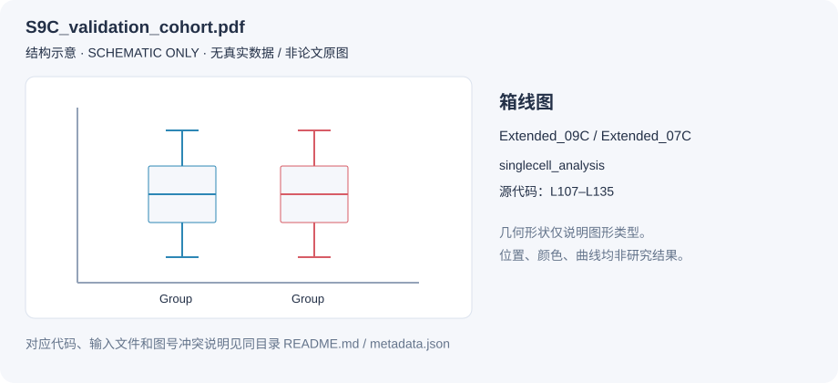

# S9C_validation_cohort.pdf

图号索引：Extended_09C / Extended_07C。图形类型：箱线图。

状态：**绘图代码，原图未上传**。

`schematic.svg` 仅说明代码使用的图形结构，无真实数据，不代表实际分布、趋势或显著性。

- [对应代码片段](plot_code.R)：原脚本第 107–135 行，逐字保留。
- [完整原始代码](source_original.R)：包含共享函数、加载、上游变量和其他图的完整上下文。
- [原仓库固定版本](https://github.com/Han-Z02/HTAN_Lung/blob/9afc9d6f5e6e15a9c365f6ec5ce661d299ad0108/singlecell_analysis/codes/code_lymphoid_panels.R#L107-L135)：`singlecell_analysis/codes/code_lymphoid_panels.R`。
- 原始保存命令行：133；输出名/条目标识：`S9C_validation_cohort.pdf`。
- [机器可读说明](metadata.json)：图号、来源、SHA-256、代码行范围及批次信息。

片段用于定位和阅读，可能包含跨图共享对象或未闭合的循环上下文，不保证单独运行。完整代码保持原样，直接执行会生成该原脚本中的其他图。R 代码中的 `../data/`、`../zenodo_data/` 和 `../../figures/` 应相对于原脚本工作目录理解；空间脚本的 `./data/` 应从 `spatial_analysis/` 理解。复制到本目录后运行前需配置路径与依赖。

- 图号冲突：输出名是 S9C，但位于 S7C_continue 章节。可同时在 Extended 7C / 9C 下查找，最终论文归属待核对。

下表列出**完整原脚本**中可静态识别的输入候选，并非本图最小依赖列表；动态路径、运行时对象和外部参考库仍需查阅完整代码。可用状态仅代表文件存在，不代表所有数据已齐备。

| 输入字面值 | 仓库状态 | 推定仓库路径 |
| --- | --- | --- |
| `/R_utils/plotutils.R` | 仓库已有 | `singlecell_analysis/data/R_utils/plotutils.R` |
| `/R_utils/seuratutils.R` | 仓库已有 | `singlecell_analysis/data/R_utils/seuratutils.R` |
| `/R_utils/seuratutilsV3.R` | 仓库已有 | `singlecell_analysis/data/R_utils/seuratutilsV3.R` |
| `/R_utils/color.R` | 仓库已有 | `singlecell_analysis/data/R_utils/color.R` |
| `../zenodo_data/tcell.final.nodoublets.Rda` | 仓库缺失或动态路径 | `singlecell_analysis/zenodo_data/tcell.final.nodoublets.Rda` |
| `bcell.final.nodoublets.Rda` | 仓库缺失或动态路径 | `singlecell_analysis/codes/bcell.final.nodoublets.Rda` |
| `tnk.validation.Rda` | 仓库缺失或动态路径 | `singlecell_analysis/codes/tnk.validation.Rda` |
| `lig_rec_differential_htan_df_not_allzeros.Rda` | 仓库已有 | `singlecell_analysis/data/lig_rec_differential_htan_df_not_allzeros.Rda` |
| `viz_comb.df.Rda` | 仓库已有 | `singlecell_analysis/data/viz_comb.df.Rda` |
| `../zenodo_data/malig.Rda` | 仓库缺失或动态路径 | `singlecell_analysis/zenodo_data/malig.Rda` |

外部处理数据入口：[Zenodo 16546233](https://doi.org/10.5281/zenodo.16546233)。环境和版本要求见[原仓库 README](../../../README.md)。本整理未运行原始生物信息学分析，也未生成论文结果图。
